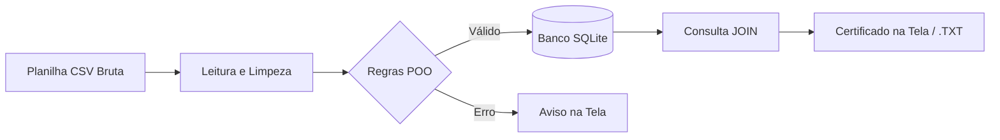
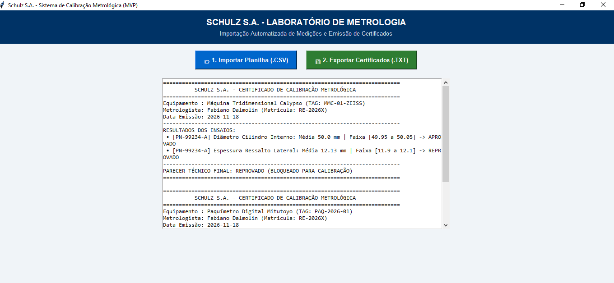

# PROJETO APLICADO I - SCHULZ S.A.
## Entrega 04: Finalização do MVP, Manual do Usuário e Executável

**Empresa Parceira:** Schulz S.A. (Laboratório de Metrologia)  
**Professores Orientadores:** Prof. MSc. Hugo Menezes Barra e Prof. Rodrigo Losina  
**Integrantes:** Fabiano Dalmolin, Felipe Sancho, Gabriel Araldi, Kauan Ramalho, Roberto Garcia  
**Repositório Oficial:** [https://github.com/fabianodalmolin/projeto-aplicado-schulz.git)](https://github.com/fabianodalmolin/projeto-aplicado-schulz.git)  

---

### 1. Arquitetura Final Integrada (Fluxo Ponta a Ponta)
O sistema foi desenvolvido para automatizar a emissão dos certificados de calibração da Schulz S.A., substituindo o cálculo manual e o cruzamento de dados em planilhas. A aplicação funciona de forma independente no Windows seguindo este fluxo:



* **Classes e Banco (`classes_04.py`):** Organizados no padrão DAO (`TecnicoDAO`, `EquipamentoDAO`, `MedicaoDAO`) com atributos protegidos (`@property`), troca automática de vírgulas por pontos e margem de tolerância de `1e-7`.
* **Leitura e Tela (`gerador_certificado_07.py`):** Lê a planilha CSV, limpa espaços sobrando e letras minúsculas nas TAGs, salva no banco `metrologia_schulz.db` e mostra o certificado na tela feita com `tkinter`.

### 2. Guia de Geração do Executável (Build)
Para o técnico da Schulz não precisar abrir o VS Code ou instalar o Python na máquina do laboratório, transformamos o código em um executável usando o **PyInstaller** através do arquivo `build_executavel.bat`.

**Comando usado para gerar o programa:**
```bat
python -m PyInstaller --onefile --windowed --name "Schulz_Calibracao" gerador_certificado_07.py
```
* `--onefile`: Junta tudo (código, classes e SQLite) em um único arquivo `Schulz_Calibracao.exe`.
* `--windowed`: Faz o programa abrir direto na tela visual, escondendo a janela preta do terminal.

### 3. Manual de Uso Operacional
Para usar o sistema no dia a dia do laboratório, basta seguir estes passos:

1. **Abrir o programa:** Dê dois cliques no arquivo **`Schulz_Calibracao.exe`**. Na primeira vez que abrir, ele já cria o banco de dados vazio na mesma pasta automaticamente.
2. **Importar a planilha:** Clique no botão azul **"1. Importar Planilha (.CSV)"** e escolha o arquivo gerado pela máquina de medição (separado por ponto e vírgula `;`).
3. **Conferir o resultado:** O sistema calcula as médias e mostra os certificados na caixa de texto. O parecer final só sai como **"APROVADO PARA USO"** se todas as medições daquela ferramenta estiverem dentro da tolerância.
4. **Salvar o certificado:** Clique no botão verde **"2. Exportar Certificados (.TXT)"** para salvar o documento final na pasta desejada.

#### Tela do Sistema em Funcionamento:


### 4. Plano de Testes Realizados
Testamos o executável usando o arquivo `dados_schulz_brutos.csv`, colocando propositalmente espaços extras, letras minúsculas e vírgulas nos números para conferir se o programa corrigia tudo sozinho:

| Caso de Teste | TAG Testada | O que foi testado | Resultado Obtido | Status |
| :--- | :--- | :--- | :--- | :--- |
| **CT-01 (Limpeza)** | ` mmc-01-zeiss ` | Espaços nas pontas, minúsculas e vírgula (`50,01`). | Arrumou para `MMC-01-ZEISS` e converteu para `50.01`. | **Passou** |
| **CT-02 (Reprovação)** | `MMC-01-ZEISS` | 1 medida aprovada e 1 medida fora da faixa (`12.13 mm`). | Reprovou a ferramenta inteira pela regra de 100%. | **Passou** |
| **CT-03 (No Limite)** | `PAQ-2026-01` | Medição exatamente no limite superior (`100.02 mm`). | Aprovou corretamente graças à margem `1e-7`. | **Passou** |

### 5. Conclusões do Projeto
Com o executável pronto e conectado ao banco SQLite, conseguimos eliminar o trabalho manual de conferir planilhas e digitar resultados no laboratório da Schulz S.A. O programa valida os dados na entrada, evita cadastros duplicados e entrega o parecer técnico pronto para o operador com apenas dois cliques.
